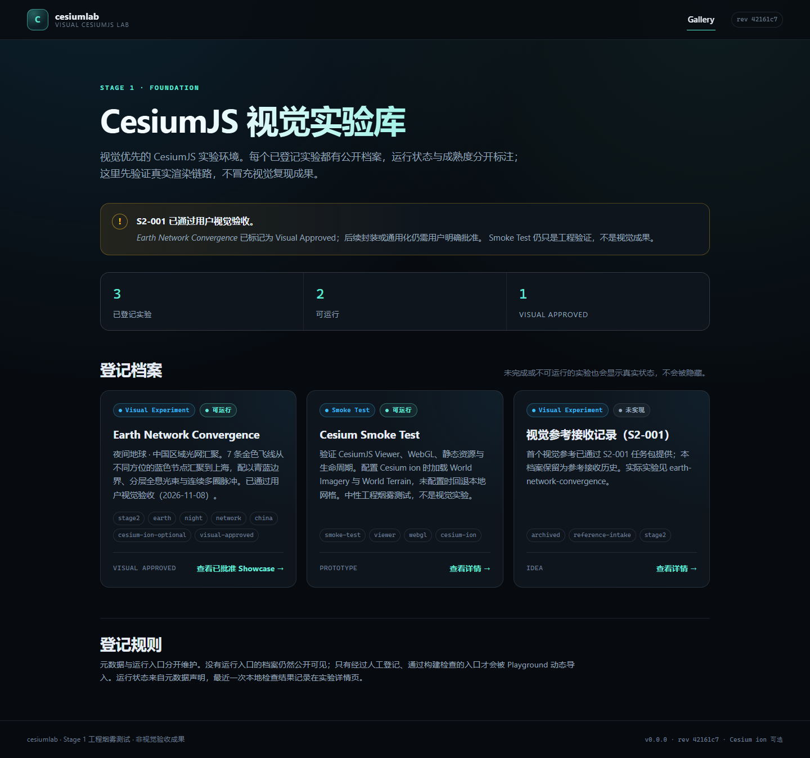
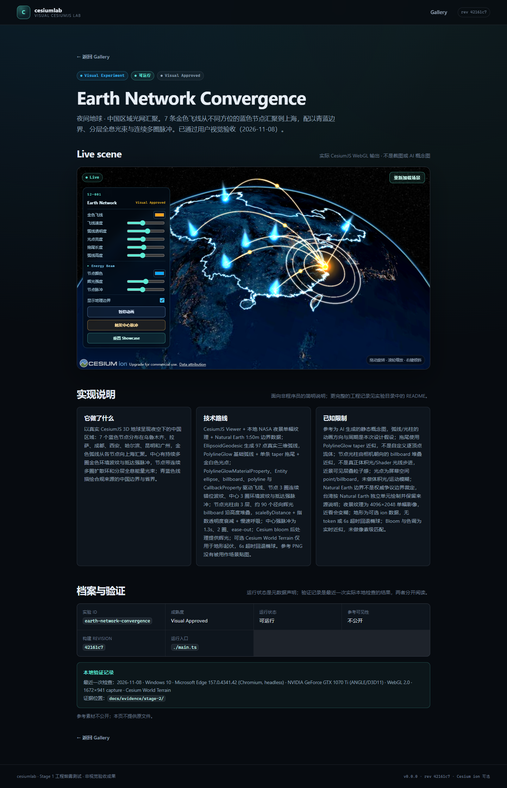
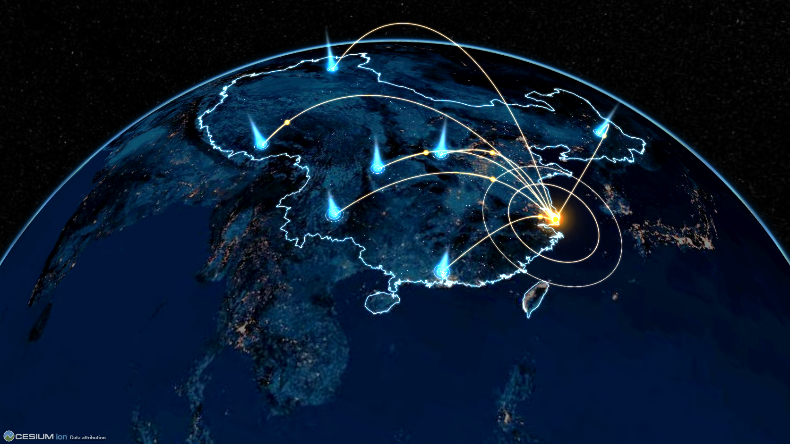

# Stage 4 公开 Playground 验证

**状态：Stage 4 完成，等待公开部署批准。**
**未部署、未发布 npm。**

## 结果

- 生产构建 + `vite preview`；
- Gallery 显示 3 个已登记档案、2 个可运行、1 个 Visual Approved；
- S2-001 可直接通过 `#/experiments/earth-network-convergence` 进入默认 Showcase；
- 刷新保持 URL 并重新创建一个场景；
- S2-001 ↔ Smoke Test 切换后 canvas 数保持 1；
- 归档实验保留详情页，不提供运行入口；
- 未知实验只显示“找不到实验”，不拖垮 Gallery；
- 归档/未运行档案仍公开可见；
- 无 console error、page error、失败请求。

## 截图







## 视觉对比

- 基线：[`docs/visual-baselines/S2-001/control-paused-1672x941.png`](../../visual-baselines/S2-001/control-paused-1672x941.png)
- 当前：`s2-001-regression.png`
- 条件：1672×941、`paused=1`、`terrain-off`、t=0
- 命令：

```powershell
magick compare -metric RMSE `
  docs/visual-baselines/S2-001/control-paused-1672x941.png `
  docs/evidence/stage-4/s2-001-regression.png null:
```

结果：**RMSE 608.698 / 归一化 0.00928814（约 0.93%）**。差异主要集中在星空/抗锯齿的高频像素与轻微采样差异；地球、弧线、节点、光束、中心环的构图与色彩层级一致。控制帧冻结了动态效果，因此同时保留 Stage 2 时间序列和已批准主截图作为动态/人眼复核基线。

## 运行

```powershell
pnpm dev
# http://127.0.0.1:5273/#/experiments/earth-network-convergence

pnpm build
pnpm preview
# http://127.0.0.1:4273/
```

Stage 4 验证：

```powershell
pnpm test:e2e:stage4
```

## 关键实现

- Gallery 继续按手工 catalog 展示全部已登记实验，成熟度与运行状态分开；
- 已批准实验卡片提供“查看已批准 Showcase”入口；
- 详情页展示简介、技术路线、局限、成熟度、运行状态、revision、验证记录；
- 运行入口按需动态导入；失败/不可运行实验不会进入执行路径；
- 新增 `?paused=1&terrain-off` 仅用于确定性视觉回归，不改变默认 Showcase；
- Cesium 资源通过既有 `sync-cesium` 与 base config 进入生产构建。

## 已知限制 / 未验证

- 未选择托管平台，未部署，未配置真实 CSP/缓存/回滚；
- 只验证 Edge/Chromium headless + NVIDIA D3D11；未验证 Firefox/Safari/移动端；
- 未做真实公网 URL、CDN、HTTPS、跨域和边缘缓存验证；
- 未做 FPS/显存/首屏指标；
- S2-001 的动态视觉仍以 Stage 2 时间序列与人工复核为准；控制帧只覆盖静态结构/色彩；
- ion 端点不稳定时回退椭球地形；公开部署前需复核 ion token 的公开客户端权限。

## 公开部署条件

- 技术构建与浏览器检查：通过；
- 静态资源路径：根路径与 `/cesiumlab/` 子路径通过既有测试；
- 未授权参考素材：不进入 public 产物；`.env.local` 不提交；
- 仍需：托管平台选择、CSP/缓存验证、公网冒烟、回滚方案、**用户公开部署批准**。

详见 [`docs/06-public-deployment.md`](../../06-public-deployment.md)。
